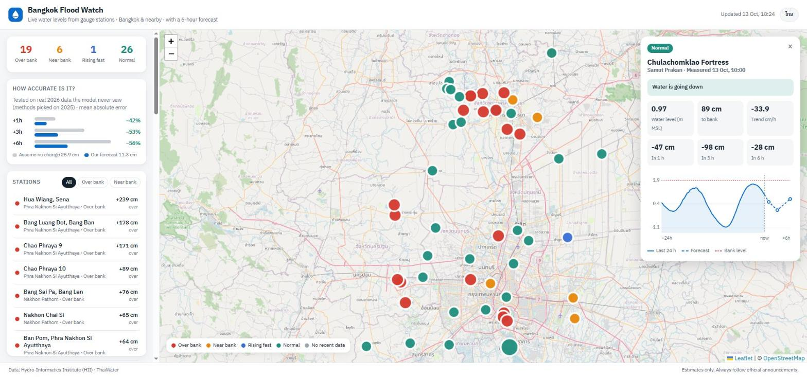

# Bangkok Flood Watch

Live water levels for Bangkok and the surrounding provinces, with a forecast for the next 6 hours.



In late September 2026 Bangkok flooded badly. The data to see it coming was already public:
the Hydro-Informatics Institute (HII) publishes a reading from hundreds of river and canal gauges
every 10 minutes. But it is raw numbers. You can't easily tell whether the canal near your house
is still rising, or how long until it tops the bank.

This project takes those readings and answers three questions for each station:

- How far is the water from the bank right now?
- Is it going up or down, and how fast?
- Where will it be in 1, 3 and 6 hours?

## How accurate is the forecast?

I didn't want a number that only looks good on paper, so the test is strict. Each station picks its
forecasting method using the 2025 rainy season only. Then it is scored on 2026 data it has never
seen, including the September flood. That's 40 stations and about 61,000 forecasts per horizon.

| Forecast ahead | Assume no change | This project | Error reduced by |
|---|---|---|---|
| 1 hour | 7.1 cm | **4.1 cm** | 42% |
| 3 hours | 16.9 cm | **7.9 cm** | 53% |
| 6 hours | 25.9 cm | **11.3 cm** | 56% |

*Mean absolute error. "Assume no change" is the baseline any forecast has to beat.*

Run it yourself with `python -m scripts.backtest_report`.

## What I learned

My first idea was to extend the current trend in a straight line. That was worse than doing
nothing at 3 and 6 hours: 41 cm of error at 6 hours, against 23 cm for "no change".

The charts showed why. The lower Chao Phraya rises and falls with the sea about twice a day,
so a river that's rising now is often about to turn around. So I added a forecast that repeats
the change seen one tidal day earlier (24 h 50 min). That cut the 6-hour error to 10 cm on tidal
stations.

Upriver in Ayutthaya there is no tide, and canal gates are opened by hand, so a single method
doesn't fit every station. Each station now picks whichever method did best on its own history.

| Method | +1 h | +3 h | +6 h |
|---|---|---|---|
| Assume no change | 6.1 cm | 14.7 cm | 23.0 cm |
| Straight-line trend | 5.1 cm | 17.2 cm | 40.7 cm |
| Fading trend | 4.8 cm | 14.1 cm | 27.3 cm |
| Tidal cycle | 4.3 cm | 7.4 cm | 10.1 cm |

*All stations, all of 2025–2026, for comparison.*

I also checked the "over bank" status against HII's own situation level. All 19 stations I flag
as over the bank are the ones HII rates at its highest level.

## Run it

Python 3.10+, nothing else for the core. `pytest` for the tests.

```bash
python -m scripts.fetch_history     # station list + 10-minute history (a few minutes)
python -m scripts.backtest_report   # accuracy table
python -m scripts.build_site        # refresh the latest readings, write web/data/
cd web && python -m http.server 8000
```

Then open http://localhost:8000. The page works in Thai and English, and on phones.

```bash
python -m pytest
```

## Layout

```
floodwatch/
  source.py     ThaiWater API calls and parsing
  store.py      SQLite storage
  trend.py      slope, forecasts, distance to the bank
  backtest.py   replay history and score each method
scripts/        command-line entry points
web/            static map page (Leaflet, no build step)
tests/
```

## Data and limits

- Water levels come from the [ThaiWater](https://www.thaiwater.net/) public API run by the
  Hydro-Informatics Institute (HII). All credit for the measurements goes to them.
- These are estimates. Don't use them to decide whether to drive through water.
  Always follow official announcements.
- Some gauges have no bank height on record. For those the page shows the trend only.

## Author

Aphisit Aoonu · [LinkedIn](https://www.linkedin.com/in/aphisit-aoonu/)
